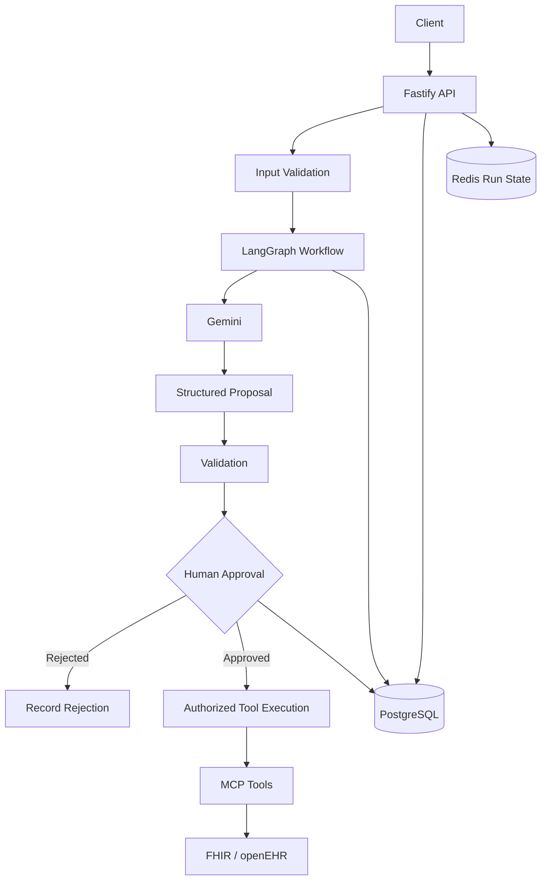

# Agentic Clinical Ops

A backend only, multi agent clinical operations system built with TypeScript, Google Gemini, LangGraph, MCP, PostgreSQL, Redis, FHIR, and openEHR.

The project explores how AI agents can assist with clinical operations while keeping clinical decisions, approvals, and external record changes under explicit control.

> **Safety principle:** AI-generated recommendations are proposals, not authorized clinical actions. Validate proposals and obtain the required human approval before executing clinical-record writes.

## Table of Contents

- [Project Overview](#project-overview)
- [Goals](#goals)
- [Architecture](#architecture)
- [Technology Stack](#technology-stack)
- [Workflow](#workflow)
- [Safety and Reliability](#safety-and-reliability)
- [Project Structure](#project-structure)
- [Prerequisites](#prerequisites)
- [Getting Started](#getting-started)
- [Environment Configuration](#environment-configuration)
- [API Endpoints](#api-endpoints)
- [Testing](#testing)
- [Documentation](#documentation)
- [Current Status](#current-status)
- [Roadmap](#roadmap)
- [Limitations](#limitations)

## Project Overview

Agentic Clinical Ops is a backend engineering project focused on orchestrating AI-assisted clinical workflows.

The system accepts a synthetic clinical operations request, runs a triage workflow, produces a structured proposal, and pauses for human review. The reviewer can approve or reject the proposal before the workflow proceeds.

The architecture combines:

- **Gemini** for AI-assisted reasoning and structured draft generation.
- **LangGraph** for workflow orchestration, state management, and human-approval interruptions.
- **MCP** for controlled access to external tools.
- **FHIR and openEHR** for healthcare interoperability experiments.
- **PostgreSQL** for durable application data, workflow records, approvals, and audit events.
- **Redis** for fast access to run-state information.
- **Fastify** for the HTTP API.

This repository is backend-only. A frontend, cloud deployment, and production clinical integration are not assumed to be implemented.

## Goals

- Build a reliable multi-step AI workflow.
- Separate AI-generated recommendations from authorized actions.
- Require explicit human approval before permitted clinical-record writes.
- Persist workflow lifecycle transitions and approval decisions.
- Prevent duplicate and conflicting approval submissions.
- Handle failures without silently treating incomplete workflows as successful.
- Explore FHIR and openEHR integration through controlled tool interfaces.
- Establish an automated test suite using synthetic scenarios.

## Architecture



PostgreSQL is the durable source for application records and audit history. Redis provides a separate run-state representation that should be reconciled if failures cause the two to diverge.

The diagram represents the intended architecture. The implementation status of individual integrations and controls should be verified against the current code before treating every path as complete.

## Technology Stack

| Technology | Purpose |
|---|---|
| TypeScript | Application language and type safety |
| Node.js | Backend runtime |
| pnpm | Package management |
| Fastify | HTTP API |
| Google Gemini | AI-assisted draft generation |
| LangGraph | Stateful workflow orchestration |
| MCP | Tool-access protocol |
| PostgreSQL | Durable persistence |
| Drizzle ORM | Database queries and schema management |
| Redis | Run-state storage |
| FHIR | Healthcare interoperability |
| openEHR / EHRbase | Clinical data modeling and interoperability |
| HAPI FHIR | FHIR server for development and integration testing |
| Vitest | Automated testing |
| Docker Compose | Local service orchestration |

## Workflow

The intended workflow is:

1. **Intake:** Receive a request and validate its patient identifier and scenario.
2. **Run creation:** Create a durable agent-run record.
3. **Triage:** Execute the LangGraph workflow.
4. **Draft generation:** Use Gemini to generate a structured proposal.
5. **Approval pause:** Interrupt the workflow for human review.
6. **Decision recording:** Persist the reviewer's approval or rejection and an audit event.
7. **Controlled continuation:** Resume the workflow according to the recorded decision.
8. **Tool execution:** For approved proposals, execute only validated and authorized operations.
9. **Completion or failure:** Update the run lifecycle and record relevant events.

### Run lifecycle

```text
running
   |
   v
awaiting_approval
   |
   v
resuming
   |
   +------> completed
   |
   +------> failed
```

A run may also transition to `failed` from `running`.

Rejected proposals must follow a rejection path that does not execute prohibited clinical-record writes.

## Safety and Reliability

This project is designed around explicit control boundaries.

### Human approval

AI-generated content must not independently authorize clinical-record changes. Approval decisions must be recorded and associated with the relevant run.

### Input validation

API payloads and scenario identifiers should be validated before workflow execution.

### Idempotency

Approval requests use an idempotency key to support safe replay of the same request. Database constraints also prevent multiple authoritative approval decisions for the same run.

### Auditability

Important workflow and approval transitions are recorded as audit events. Audit records should remain consistent with the corresponding durable state transitions.

### Failure handling

Workflow errors must not be reported as successful completion. Failure handling should update run state and support recovery from interrupted or partially completed operations.

### Clinical data safety

Development and automated tests should use synthetic patient data. Real clinical data requires appropriate authorization, privacy safeguards, access controls, and operational review.

## Project Structure

The following is a high-level guide to the repository. Exact filenames may vary as implementation evolves.

```text
agentic-clinical-ops/
├── apps/
│   └── api/
│       └── src/
│           ├── ai/          # AI and LangGraph workflows
│           ├── db/          # Database access and lifecycle logic
│           ├── redis/       # Run-state storage
│           ├── routes/      # Fastify API routes and schemas
│           └── server.ts    # API server entry point
├── tests/
│   ├── approval-routes.test.ts
│   ├── intake-routes.test.ts
│   ├── triage-graph.test.ts
│   └── README.md
├── docs/
│   └── README.md
├── .env.example
├── docker-compose.yml
├── package.json
├── pnpm-lock.yaml
├── tsconfig.json
└── README.md
```

This layout is illustrative; keep it synchronized with the actual repository.

## Prerequisites

Install or configure the following:

- A supported Node.js version compatible with the project.
- pnpm.
- Docker and Docker Compose.
- A PostgreSQL instance.
- A Redis instance.
- A Google Gemini API key for live AI requests.
- Local FHIR and openEHR services if testing those integrations.

Check the package configuration for the project's exact Node.js and pnpm versions.

## Getting Started

### 1. Install dependencies

From the repository root:

```bash
pnpm install
```

### 2. Configure environment variables

Copy the example environment file:

```bash
cp .env.example .env
```

Fill in the required local database, Redis, AI-provider, and integration settings.

**Never commit `.env` or expose API keys, passwords, access tokens, or patient data.**

### 3. Start local services

If your Docker Compose configuration defines the required services, start them with:

```bash
docker compose up -d
```

Inspect the configured services:

```bash
docker compose ps
```

### 4. Apply database migrations

Use the migration command configured in `package.json`. For example, if the project uses Drizzle Kit:

```bash
pnpm exec drizzle-kit migrate
```

Confirm the project's Drizzle configuration and migration scripts before running commands against any database. Use a dedicated development or test database.

### 5. Run type checking and tests

```bash
pnpm typecheck
pnpm test
```

### 6. Start the API

Use the development script defined in `package.json`. A common command is:

```bash
pnpm dev
```

If the repository uses a different script name, follow `package.json`.

## Environment Configuration

The exact variable names are defined in `.env.example` and the application's configuration code.

Common configuration categories include:

| Category | Purpose |
|---|---|
| Database | PostgreSQL connection URL |
| Redis | Redis connection URL |
| Gemini | API key and model configuration |
| FHIR | HAPI FHIR base URL and credentials if required |
| openEHR | EHRbase endpoint and credentials if required |
| API | Host, port, and runtime settings |

Do not put actual secret values in this README. Keep `.env.example` limited to variable names and safe placeholder values.

The application should validate required configuration during startup and fail clearly when required settings are missing.

## API Endpoints

The endpoints below reflect the current route design discussed in this project. Confirm the exact request schemas and response formats in the route implementations.

### Create an intake run

`POST /api/intake`

Example request:

```json
{
  "patientId": "synthetic-patient-001",
  "scenarioId": "demo-001"
}
```

Expected behavior:

- Validate the payload.
- Create an agent run.
- Execute the triage graph.
- Pause at human approval.
- Return the run identifier and draft when successful.

A successful intake is expected to return HTTP `201` with a run identifier and an `awaiting_approval` status.

Invalid payloads should return HTTP `400`. Workflow failures should not be reported as successful intake.

### Submit an approval decision

`POST /api/runs/:runId/approval`

Required header:

```text
Idempotency-Key: unique-request-key
```

Example request:

```json
{
  "decision": "approved",
  "reviewerId": "synthetic-reviewer-001"
}
```

Allowed decisions:

- `approved`
- `rejected`

The route validates the request and records the decision. The same request may be replayed using the same idempotency key. Conflicting decisions for an already-decided run should be rejected.

**Security note:** The `reviewerId` field is a request value, not authentication. A real deployment must authenticate the caller and authorize that caller to review the run.

### Error responses

The current implementation includes validation errors and conflict responses for approval requests. Unexpected failures should be logged safely and returned using a consistent error format.

Do not expose stack traces, credentials, or sensitive clinical information in client-facing error responses.

## Testing

Run all tests:

```bash
pnpm test
```

Run type checking:

```bash
pnpm typecheck
```

Run individual test files:

```bash
pnpm exec vitest run tests/approval-routes.test.ts
pnpm exec vitest run tests/intake-routes.test.ts
pnpm exec vitest run tests/triage-graph.test.ts
```

### Current coverage

The existing tests cover:

- Approval request validation.
- Missing idempotency keys.
- Successful approval and workflow completion.
- Exact approval replay.
- Conflicting approval decisions.
- Concurrent approval submissions.
- Triage graph draft-generation failure.
- Intake failure handling and failed run-state persistence.

Continue expanding coverage for rejection behavior, workflow recovery, invalid checkpoints, MCP failures, and clinical write safeguards.

For additional testing instructions, see [`tests/README.md`](tests/README.md).

## Documentation

- [`docs/README.md`](docs/README.md) — development roadmap and implementation status.
- [`tests/README.md`](tests/README.md) — test execution instructions and test coverage roadmap.
- [`.env.example`](.env.example) — environment variable template.

Keep documentation synchronized with the actual code and test results.

## Current Status

The project has implemented core backend workflow components, including intake, LangGraph approval interruption, approval recording, idempotency protections, and initial failure-handling tests.

It remains an evolving development project. Do not assume every item in the architecture diagram or roadmap is fully implemented or production-ready.

Before considering a milestone complete, verify the implementation, automated tests, configuration, and failure behavior.

## Roadmap

### Reliability

- [ ] Complete failure-recovery tests for interrupted workflow resumption.
- [ ] Define retry behavior after an approval has been persisted.
- [ ] Verify valid and invalid lifecycle transitions.
- [ ] Reconcile PostgreSQL and Redis state when partial failures occur.

### Clinical safety and interoperability

- [ ] Test the full rejection path.
- [ ] Verify that rejected proposals cannot cause clinical-record writes.
- [ ] Validate approved proposals before executing tools.
- [ ] Test FHIR and openEHR validation errors and timeouts.
- [ ] Ensure MCP clients are cleaned up on success and failure.

### Security

- [ ] Implement authentication and reviewer authorization.
- [ ] Restrict access to run and patient-related information.
- [ ] Validate environment configuration at startup.
- [ ] Review logging, rate limiting, timeouts, and secret handling.

### Documentation and release readiness

- [ ] Document exact environment variables and service requirements.
- [ ] Document database setup and migration commands.
- [ ] Document request and response schemas.
- [ ] Run the complete test suite in a reproducible environment.
- [ ] Document known limitations and recovery procedures.

See [`docs/README.md`](docs/README.md) for the detailed development roadmap.

## Limitations

This project is an engineering prototype, not a certified clinical decision-support or production healthcare system.

It does not replace clinical judgment, institutional policies, or regulatory requirements. Any use with real patient information or operational clinical systems requires appropriate security, privacy, clinical safety, interoperability, and compliance review.

The project should be demonstrated with synthetic scenarios until those requirements are independently assessed.

## Contributing

When extending the project:

1. Keep AI recommendations separate from executable actions.
2. Preserve validation and human-approval boundaries.
3. Add tests for successful and failure paths.
4. Use synthetic data in development and tests.
5. Keep database migrations and documentation synchronized with schema changes.
6. Never commit secrets or sensitive clinical information.

## License

The project is licensed under the MIT License. See [LICENSE](LICENSE) for details.
