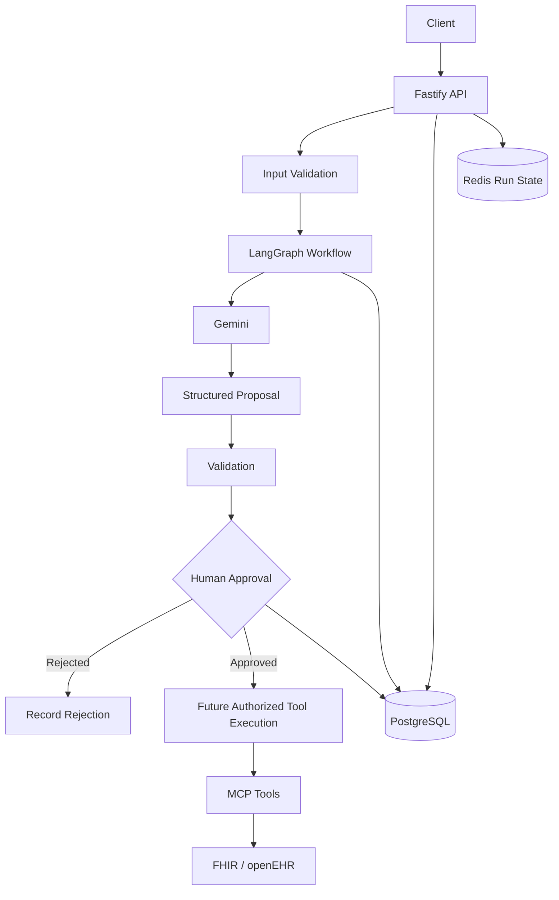
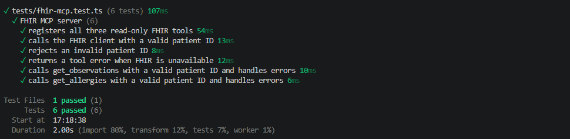
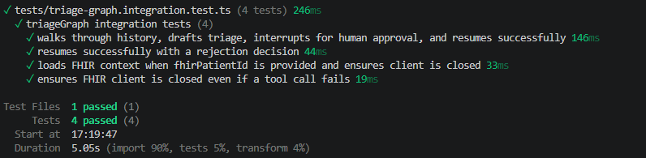

# Agentic Clinical Ops

A backend only, multi agent clinical operations system built with TypeScript, Google Gemini, LangGraph, MCP, PostgreSQL, Redis, FHIR, and openEHR.

The project explores how AI agents can assist with clinical operations while keeping clinical decisions, approvals, and any future external record changes under explicit control.

> **Safety principle:** AI generated recommendations are proposals, not authorized clinical actions. Validate proposals and obtain the required human approval before executing clinical record writes. This repository currently implements read only FHIR/openEHR clients; it does not implement clinical record writes.

## Table of Contents

- [Agentic Clinical Ops](#agentic-clinical-ops)
  - [Table of Contents](#table-of-contents)
  - [Project Overview](#project-overview)
  - [Goals](#goals)
  - [Architecture](#architecture)
  - [Technology Stack](#technology-stack)
  - [Workflow](#workflow)
    - [Run lifecycle](#run-lifecycle)
  - [Safety and Reliability](#safety-and-reliability)
    - [Human approval](#human-approval)
    - [Input validation](#input-validation)
    - [Idempotency](#idempotency)
    - [Auditability](#auditability)
    - [Failure handling](#failure-handling)
    - [Clinical data safety](#clinical-data-safety)
  - [Project Structure](#project-structure)
  - [Prerequisites](#prerequisites)
  - [Local Infrastructure](#local-infrastructure)
  - [Getting Started](#getting-started)
    - [1. Install dependencies](#1-install-dependencies)
    - [2. Configure environment variables](#2-configure-environment-variables)
    - [3. Start local services](#3-start-local-services)
    - [4. Apply database migrations](#4-apply-database-migrations)
    - [5. Run type checking and tests](#5-run-type-checking-and-tests)
    - [6. Start the API](#6-start-the-api)
  - [Environment Configuration](#environment-configuration)
  - [API Endpoints](#api-endpoints)
    - [Create an intake run](#create-an-intake-run)
    - [Submit an approval decision](#submit-an-approval-decision)
    - [Error responses](#error-responses)
  - [Testing](#testing)
    - [Current coverage](#current-coverage)
  - [Documentation](#documentation)
  - [Current Status](#current-status)
  - [Roadmap](#roadmap)
    - [Reliability](#reliability)
    - [Clinical safety and interoperability](#clinical-safety-and-interoperability)
    - [Security](#security)
    - [Documentation and release readiness](#documentation-and-release-readiness)
  - [Limitations](#limitations)
  - [Contributing](#contributing)
  - [License](#license)

## Project Overview

Agentic Clinical Ops is a backend engineering project focused on orchestrating AI assisted clinical workflows.

The system accepts a synthetic clinical operations request, runs a triage workflow, produces a structured proposal, and pauses for human review. The reviewer can approve or reject the proposal before the workflow proceeds.

The architecture combines:

- **Gemini** for AI assisted reasoning and structured draft generation.
- **LangGraph** for workflow orchestration, state management, and human-approval interruptions.
- **MCP** for controlled access to external tools.
- **FHIR and openEHR** for healthcare interoperability experiments.
- **PostgreSQL** for durable application data, workflow records, approvals, and audit events.
- **Redis** for fast access to run-state information.
- **Fastify** for the HTTP API.

This repository is backend only. A frontend, cloud deployment, and production clinical integration are not assumed to be implemented.

## Goals

- Build a reliable multi-step AI workflow.
- Separate AI generated recommendations from authorized actions.
- Require explicit human approval before any future permitted clinical-record writes.
- Persist workflow lifecycle transitions and approval decisions.
- Prevent duplicate and conflicting approval submissions.
- Handle failures without silently treating incomplete workflows as successful.
- Explore FHIR and openEHR integration through controlled tool interfaces.
- Establish an automated test suite using synthetic scenarios.

## Architecture



PostgreSQL is the durable source for application records and audit history. Redis provides a separate run state representation that should be reconciled if failures cause the two to diverge.

The diagram is a target architecture, not a claim that every component is implemented. Current FHIR/openEHR clients are read-only, and the approved write execution path is not implemented.

## Technology Stack

| Technology | Purpose |
|---|---|
| TypeScript | Application language and type safety |
| Node.js | Backend runtime |
| pnpm | Package management |
| Fastify | HTTP API |
| Google Gemini | AI assisted draft generation |
| LangGraph | Stateful workflow orchestration |
| MCP | Tool-access protocol |
| PostgreSQL | Durable persistence |
| Drizzle ORM | Database queries and schema management |
| Redis | Run state storage |
| FHIR | Healthcare interoperability |
| openEHR / EHRbase | Clinical data modeling and interoperability |
| HAPI FHIR | FHIR server for development and integration testing |
| Vitest | Automated testing |
| Docker Compose | Local service orchestration |

## Workflow

The current workflow validates an intake request, creates a run, generates a structured triage draft, and pauses for an authenticated reviewer. The reviewer decision is persisted and the graph resumes. The following final write execution step is not implemented:

The intake schema requires `symptoms`, but the current route passes only
`scenarioId` into the graph. The synthetic demo scenarios, rather than the
submitted symptom list, currently drive the triage draft.

1. **Intake:** Receive a request and validate its patient identifier and scenario.
2. **Run creation:** Create a durable agent run record.
3. **Triage:** Execute the LangGraph workflow.
4. **Draft generation:** Use Gemini to generate a structured proposal.
5. **Approval pause:** Interrupt the workflow for human review.
6. **Decision recording:** Persist the reviewer's approval or rejection and an audit event.
7. **Controlled continuation:** Resume the workflow according to the recorded decision.
8. **Future tool execution:** For approved proposals, execute only validated and authorized operations. No clinical write executor currently exists.
9. **Completion or failure:** Update the run lifecycle and record relevant events.

### Run lifecycle

```Plaintext
running
   |
   v
awaiting_approval
   |
   v
resuming
   |
   +------> completed
   |
   +------> failed
```

A run may also transition to `failed` from `running`.

Rejected proposals must follow a rejection path that does not execute prohibited clinical record writes.

## Safety and Reliability

This project is designed around explicit control boundaries.

### Human approval

AI-generated content must not independently authorize clinical-record changes. Approval decisions must be recorded and associated with the relevant run.

### Input validation

API payloads and scenario identifiers should be validated before workflow execution.

### Idempotency

Approval requests use an idempotency key to support safe replay of the same request. Database constraints also prevent multiple authoritative approval decisions for the same run.

### Auditability

Important workflow and approval transitions are recorded as audit events. Audit records should remain consistent with the corresponding durable state transitions.

### Failure handling

Workflow errors must not be reported as successful completion. Failure handling should update run state and support recovery from interrupted or partially completed operations.

### Clinical data safety

Development and automated tests should use synthetic patient data. Real clinical data requires appropriate authorization, privacy safeguards, access controls, and operational review.

## Project Structure

The following is a high level guide to the repository.

```text
agentic-clinical-ops/
├── apps/
│   └── api/
│       └── src/
│           ├── ai/          # AI and LangGraph workflows
│           ├── db/          # Database access and lifecycle logic
│           ├── redis/       # Run state storage
│           ├── routes/      # Fastify API routes and schemas
│           └── server.ts    # API server entry point
├── tests/
│   ├── approval-routes.test.ts
│   ├── intake-routes.test.ts
│   ├── triage-graph.test.ts
│   └── README.md
├── docs/
│   └── README.md
├── infrastructure/
│   ├── docker-compose.yml
│   ├── openehr/
│   └── README.md
├── .env.example
├── package.json
├── pnpm-lock.yaml
├── tsconfig.json
├── README.md
└── LICENSE.md
```

## Prerequisites

Install or configure the following:

- A supported Node.js version compatible with the project.
- pnpm.
- Docker and Docker Compose.
- A PostgreSQL instance.
- A Redis instance.
- A Google Gemini API key for live AI requests.
- Local FHIR and openEHR services if testing those integrations.

Check the package configuration for the project's exact Node.js and pnpm versions.

## Local Infrastructure

The repository's Docker Compose stack provides local PostgreSQL, Redis, HAPI
FHIR, EHRbase, and Keycloak services. See the
[infrastructure/README.md](infrastructure/README.md) for service ports, startup
commands, connection settings, and development-only security notes.

## Getting Started

### 1. Install dependencies

From the repository root:

```bash
pnpm install
```

### 2. Configure environment variables

Copy the example environment file:

```bash
cp .env.example .env
```

Fill in the local database, Redis, AI provider, and integration settings.
The API also requires `AUTH_ISSUER`, `AUTH_AUDIENCE`, and `AUTH_JWKS_URL` for
JWT authentication. Intake and approval requests must carry a valid RS256
token whose `iss` and `aud` claims match configuration and whose `sub` is the
reviewer identity. Approval/rejection additionally requires the configured
role in the token's `roles` array (`AUTH_REVIEWER_ROLE`, default: `reviewer`).
The `/health` endpoint is public.

**Never commit `.env` or expose API keys, passwords, access tokens, or patient data.**

### 3. Start local services

Start the local development services described in the
[infrastructure guide](infrastructure/README.md):

```bash
docker compose -f infrastructure/docker-compose.yml up -d
```

Inspect the configured services:

```bash
docker compose -f infrastructure/docker-compose.yml ps
```

### 4. Apply database migrations

Check migration consistency without applying changes:

```bash
pnpm db:check
```

Generate migrations from schema changes with `pnpm db:generate`. Apply them
only to a dedicated development or test database:

```bash
pnpm db:migrate
```

`pnpm db:migrate` changes the configured database. Verify `DATABASE_URL` before
running it.

### 5. Run type checking and tests

```bash
pnpm typecheck
pnpm test
```

### 6. Start the API

Use the development script defined in `package.json`. A common command is:

```bash
pnpm dev
```

If the repository uses a different script name, follow `package.json`.

## Environment Configuration

The exact variable names are defined in `.env.example` and the application's configuration code.

Common configuration categories include:

| Category | Purpose |
|---|---|
| Database | PostgreSQL connection URL |
| Redis | Redis connection URL |
| Gemini | API key and model configuration |
| FHIR | HAPI FHIR base URL and credentials if required |
| openEHR | EHRbase endpoint and credentials if required |
| Reviewer authentication | OIDC issuer, audience, JWKS URL, and reviewer role |
| API | Host, port, and runtime settings |

The current FHIR and openEHR clients expose read operations only. No clinical
record write operation is implemented in this repository.

Do not put actual secret values in this README. Keep `.env.example` limited to variable names and safe placeholder values.

The application should validate required configuration during startup and fail clearly when required settings are missing.

## API Endpoints

These endpoints and request bodies reflect the current route implementations. Both endpoints require a valid RS256 bearer token whose issuer and audience match configuration. The approval endpoint also requires the configured reviewer role.

### Create an intake run

`POST /api/v1/api/intake`

The `/api/v1` prefix is registered by the server and the route currently includes its own `/api` segment. Consider simplifying this path in a future API cleanup.

Required header:

```text
Authorization: Bearer <OIDC access token>
```

Example request:

```json
{
  "patientId": "synthetic-patient-001",
  "symptoms": ["synthetic headache"],
  "scenarioId": "demo-001"
}
```

Expected behavior:

- Validate the payload.
- Create an agent run.
- Execute the triage graph.
- Pause at human approval.
- Return the run identifier and draft when successful.

A successful intake is expected to return HTTP `201` with a run identifier and an `awaiting_approval` status.

Invalid payloads should return HTTP `400`. Workflow failures should not be reported as successful intake.

### Submit an approval decision

`POST /api/runs/:runId/approval`

Required headers:

```text
Authorization: Bearer <OIDC access token with reviewer role>
Idempotency-Key: unique-request-key
```

Example request:

```json
{
  "decision": "approved"
}
```

Allowed decisions:

- `approved`
- `rejected`

The route validates the request and records the decision using the authenticated token's `sub` as the reviewer identity; request body `reviewerId` is not accepted as identity proof. The same request may be replayed using the same idempotency key. Conflicting decisions for an already decided run are rejected.

Authentication requires `AUTH_ISSUER`, `AUTH_AUDIENCE`, and `AUTH_JWKS_URL`. Approval and rejection additionally require the role configured by `AUTH_REVIEWER_ROLE` (default `reviewer`). The public health endpoint is `GET /health`.

### Error responses

The current implementation includes validation errors and conflict responses for approval requests. Unexpected failures should be logged safely and returned using a consistent error format.

Do not expose stack traces, credentials, or sensitive clinical information in client facing error responses.

## Testing

Run all tests:

```bash
pnpm test
```

Run type checking:

```bash
pnpm typecheck
```

Run individual test files:

```bash
pnpm exec vitest run tests/approval-routes.test.ts
pnpm exec vitest run tests/intake-routes.test.ts
pnpm exec vitest run tests/triage-graph.test.ts
```

### Current coverage

The current test suite covers:

- Intake validation, authentication, and graph failure handling.
- Approval/rejection routes, reviewer authorization, idempotency, and resume failure retry.
- Workflow lifecycle and graph behavior using synthetic data and mocked dependencies.
- MCP client cleanup after success and tool call failure.
- JWT verification and runtime environment validation.

Last verified in this checkout: `pnpm test` passed all 73 tests in 19 files;
`pnpm typecheck` passed. Run `pnpm db:check` to validate migration-file
consistency. Applied migration state has not been verified here.

### Focused test results

These terminal captures show passing, synthetic or mocked test runs. The FHIR
MCP tests exercise read-only tools; the graph context test uses a mocked FHIR
client and does not connect to an openEHR or live FHIR system.

**LangGraph workflow — approval interrupt, rejection, and resume**


**FHIR MCP server — read-only tools and error handling**



**LangGraph with mocked FHIR context — approval/rejection and MCP cleanup**



For additional testing instructions, see [`tests/README.md`](tests/README.md).

## Documentation

- [`docs/README.md`](docs/README.md) — development roadmap and implementation status.
- [`tests/README.md`](tests/README.md) — test execution instructions and test coverage roadmap.
- [`infrastructure/README.md`](infrastructure/README.md) — local Docker Compose services, ports, connection settings, and development-only security notes.
- [`.env.example`](.env.example) — environment variable template.

Keep documentation synchronized with the actual code and test results.

## Current Status

The project has implemented intake validation, a LangGraph approval interruption, approval/rejection recording, JWT reviewer authentication and authorization, idempotency protections, resume failure retry behavior, and synthetic tests.

FHIR/openEHR access is read only; no clinical write executor exists. Database migration files have been consistency checked, but migrations have not been applied as part of this verification. The project remains a prototype and is not production ready.

Before considering a milestone complete, verify the implementation, automated tests, configuration, and failure behavior.

## Roadmap

### Reliability

- [x] Test retry after approval persistence succeeds but graph resumption fails.
- [x] Test approval idempotency, conflicting decisions, and concurrent submissions.
- [x] Verify key valid and invalid lifecycle transitions.
- [ ] Define recovery/reconciliation for process crashes and runs stuck in `resuming`.
- [ ] Reconcile PostgreSQL and Redis state when partial failures occur.
- [ ] Decide how validated intake symptoms should be safely represented in graph context.

### Clinical safety and interoperability

- [x] Test rejection persistence, final run state, and audit event.
- [ ] Implement and test a write executor that validates proposals and gates writes behind approval.
- [ ] Verify rejected proposals cannot cause clinical record writes once a write executor exists.
- [ ] Validate approved proposals before executing tools.
- [ ] Test FHIR and openEHR validation errors and timeouts.
- [x] Test MCP client cleanup on success and tool-call failure.
- [ ] Test MCP timeouts and client-close failures.

### Security

- [x] Verify JWT authentication and configured reviewer role authorization for intake and approval routes.
- [ ] Define and enforce finer grained authorization for run/patient access as those endpoints are added.
- [x] Validate required environment configuration at startup.
- [x] Keep `.env` excluded from Git and use placeholders in `.env.example`.
- [ ] Review production logging, rate limiting, request limits, and timeouts.

### Documentation and release readiness

- [x] Document environment variables and reviewer authentication configuration.
- [x] Document database migration commands and warn that applying migrations mutates the configured database.
- [x] Document intake and approval request schemas.
- [x] Run the full test suite and TypeScript check.
- [x] Document the missing clinical write executor and unverified applied migration state.
- [ ] Verify migrations against a dedicated database and document repeatable test database setup.
- [ ] Document operational recovery/reconciliation procedures.

See [`docs/README.md`](docs/README.md) for the detailed development roadmap.

## Limitations

This project is an engineering prototype, not a certified clinical decision support or production healthcare system.

It does not replace clinical judgment, institutional policies, or regulatory requirements. Any use with real patient information or operational clinical systems requires appropriate security, privacy, clinical safety, interoperability, and compliance review.

The project should be demonstrated with synthetic scenarios until those requirements are independently assessed. FHIR/openEHR interactions are read only in the current implementation. Submitted symptoms are validated but are not currently passed to the workflow; triage uses the selected synthetic scenario.

## Contributing

When extending the project:

1. Keep AI recommendations separate from executable actions.
2. Preserve validation and human approval boundaries.
3. Add tests for successful and failure paths.
4. Use synthetic data in development and tests.
5. Keep database migrations and documentation synchronized with schema changes.
6. Never commit secrets or sensitive clinical information.

## License

The project is licensed under the MIT License. See [LICENSE](LICENSE) for details.
